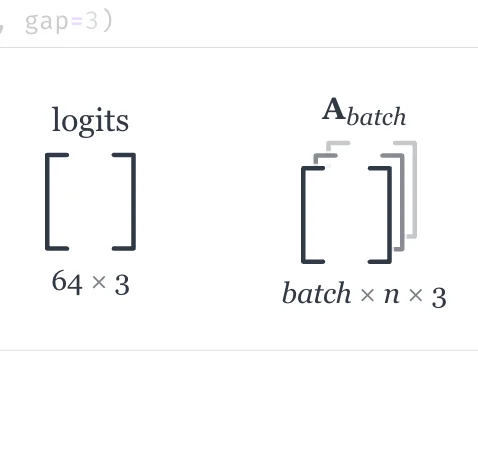

# array_display API

<!-- no-md -->
<div class="wiggly-demo-wrap">
<button class="wiggly-demo" type="button" data-demo="array_display" data-demo-title="array_display live demo">

<span class="wiggly-demo__cta">Run this demo live in your browser <span class="wiggly-demo__play">▶</span></span>
</button>
</div>
<!-- /no-md -->

marimo prints arrays in full. When the story is "this cell holds a 128×2
matrix", the 256 numbers underneath are noise. `array_display` returns a real
`numpy.ndarray` subclass whose marimo output is just the *shape*: empty matrix
brackets with a caption underneath.

```python
import numpy as np
from wigglystuff import array_display

X = array_display(np.zeros((128, 2)), display_shape=("n", None), name=r"$\mathbf{X}$")
```

`X + 1`, `X[:10]`, `X.T`, and every other NumPy operation keep working, and
array-valued results keep the display. Use `.value` whenever you want the same
data as a plain `ndarray` again.

## display_shape

One entry per axis, set at construction or later through the property:

- a **string** renders as a symbolic dimension — `"n"` stays `n`, whatever the
  actual size is that day;
- `None` renders that axis's **live size**, so growing the data updates the
  caption.

`("n", None)` on a `(128, 2)` array reads *n × 2*. The labels follow the data
through operations: elementwise math, slicing, fancy indexing, and stacking
keep them, and axis permutations (`transpose`, `.T`, `swapaxes`, `rot90`,
`moveaxis`) reorder them so the caption stays truthful. Results with fewer
dimensions — a row sum, a mean — fall back to marimo's plain display.

For 3D arrays the glyph becomes three bracket pairs stacked like sheets of
paper: each sheet hides whatever falls behind it, so the planes never blend
into each other and the interior of the front brackets stays empty.

## name

An optional label above the glyph:

```python
array_display(np.zeros((64, 3)), name="logits")
array_display(np.zeros((4, 4)), name="X")                    # lone letter: italic
array_display(np.zeros((4, 4)), name=r"$\mathbf{X}$")        # bold X
array_display(np.zeros((32, 8, 3)), name=r"$\mathbf{A}_{batch}$")
```

Plain strings render in serif — a lone letter as an italic math variable,
anything longer (words, phrases) upright. Strings that contain TeX commands or
are wrapped in `$...$` render through a small LaTeX subset — `\mathbf`,
`\boldsymbol`, Greek, accents (`\hat`, `\tilde`), sub/superscripts, `\mathbb`,
`\mathcal`, and common symbols — converted to Unicode, so nothing is loaded
and nothing needs JavaScript. Unsupported commands degrade to readable text.

The name follows the data like the labels do: views and elementwise results
keep it, arrays rebuilt from several inputs (say `np.concatenate`) drop it,
since they are no longer that variable.

Requires NumPy when used (`pip install wigglystuff[numpy]`); the rest of
wigglystuff imports fine without it.

::: wigglystuff.array_display.array_display
