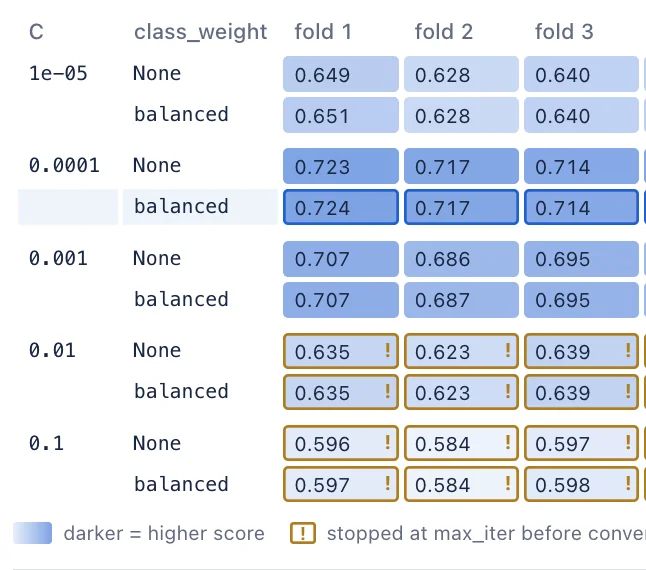

# FitProgress API

<!-- no-md -->
<div class="wiggly-demo-wrap">
<button class="wiggly-demo" type="button" data-demo="fit_progress" data-demo-title="FitProgress live demo">

<span class="wiggly-demo__cta">Run this demo live in your browser <span class="wiggly-demo__play">▶</span></span>
</button>
</div>
<!-- /no-md -->

scikit-learn 1.9 added **callbacks**: an estimator reports every task it runs,
such as each candidate/fold fit of a search and each solver iteration inside
it. Its built-in `ProgressBar` callback draws these with `rich`, which works
well in a terminal but becomes a tall static text block in a notebook.
`FitProgress` draws the same events as a widget.

Display the widget, then fit through it:

```python
from sklearn.linear_model import LogisticRegression
from sklearn.model_selection import GridSearchCV
from wigglystuff import FitProgress

progress = FitProgress()
progress  # show it in one cell ...

# ... and fit through it in another; you get the fitted search back
grid = progress.fit(
    GridSearchCV(
        LogisticRegression(max_iter=150),
        {"C": [1e-4, 1e-3, 1e-2], "class_weight": [None, "balanced"]},
        cv=5,
    ),
    X,
    y,
)
```

`GridSearchCV` and `RandomizedSearchCV` render as a grid with one row per
candidate (one column per hyperparameter) and one column per fold:

- A **running** cell fills up with the inner estimator's progress, for example
  its lbfgs iterations.
- A **finished** cell shows its test score, shaded darker for better scores.
  Each row shows its mean once all its folds are in, and when the search is
  done the best row is highlighted.
- A cell outlined in amber used every iteration (`max_iter`), so the solver may
  not have converged. A failed fit is outlined in red.
- **Hover** a cell to see its parameters, iterations, fit time, score and rank.
- The **refit** gets one bar at the bottom, with the chosen parameters below it.

Estimators report progress in different ways. A `Pipeline` reports its steps,
and the final estimator inside it can still report iterations; hover a cell to
see both. An estimator without callback support, such as a random forest,
reports nothing while it fits. Its cells show a striped bar until the fit
finishes and then get their score.

`fit` attaches its callback only for the duration of the fit, so the returned
estimator keeps exactly the callbacks it had before. To show test scores while
the search runs, it also wraps a single-metric search's scorer during the fit
and puts the original `scoring` and `scorer_` back afterwards. A multi-metric
search shows its scores (for the `refit` metric) once it is done. Fits that
run in worker processes (`n_jobs`) report back live too.

Outside a notebook, `fit` uses scikit-learn's own terminal `ProgressBar` when
`rich` is installed, and otherwise fits without progress.

Requires scikit-learn 1.9 or later (`pip install wigglystuff[sklearn]`). The
callback API is experimental in scikit-learn, and `FitProgress` uses its
private `sklearn.callback._transport` module to receive events from worker
processes, so a future scikit-learn release may need an update here.

::: wigglystuff.fit_progress.FitProgress

## Synced traitlets

| Traitlet | Type | Notes |
| --- | --- | --- |
| `tasks` | `list[dict]` | One dict per task that reports progress: `path` (task ids from the root), `estimator`, `task`, `source_task`, `total`/`done` subtasks, `state`, `start_ms`/`end_ms`, and for search fits `params`, `max_iter`, `unit` (what its subtasks count, e.g. `"lbfgs-iter"`) and the live test `score`. |
| `candidates` | `list[dict]` | Formatted parameters of each candidate: known up front for `GridSearchCV`, from `cv_results_` once a search is done. |
| `scores` | `dict \| None` | After a search: `metric`, `folds` (candidate × fold test scores, `None` for failed fits), `mean`, `rank`, `best_index`. |
| `color` | `str` | CSS color for the bars, the score shading and the best row; `""` uses the default blue. |
| `status` | `str` | `"idle"`, `"running"`, `"done"` or `"error"`. |
| `started_ms` | `float` | Epoch ms when the fit started. |
| `now_ms` | `float` | Kernel clock at the last update. |
| `sync_throttle_ms` | `int` | Minimum ms between updates sent to the browser while fitting. |
