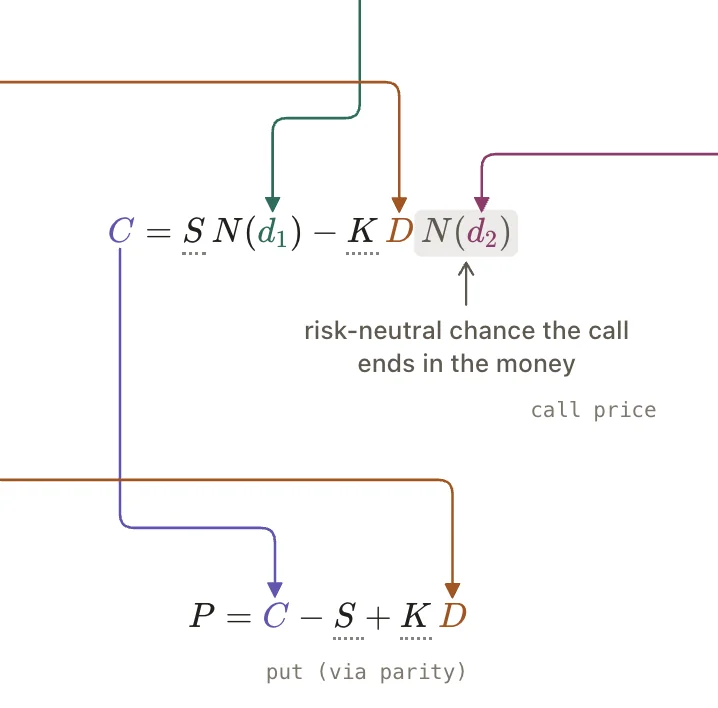

# FormulaDAG API

<!-- no-md -->

<button class="wiggly-demo" type="button" data-demo="formula_dag" data-demo-title="FormulaDAG live demo">

Run this demo live in your browser ▶
</button>

<!-- /no-md -->

`FormulaDAG` lays out a set of LaTeX formulas as a DAG. Name each formula and
write `\use{name}` inside another one: the widget renders that formula's output
symbol in place, infers the edge, and draws an arrow from the producer straight
onto the spot where it's used. Formulas flow top to bottom by dependency depth,
and each producer gets one color for its symbol, its arrows, and every use.
Hover a formula to highlight what it depends on and what depends on it; click
it to set `selected`.

Draggable `\tangle{name}` numbers and `\note{name}{...}` notes work like in
[TangleLatex](tangle-latex.md), shared across the whole DAG. Give a formula an
`fn` (its argument names pick parameters or other formulas) and its value is
computed live into `outputs`. While you drag a number, every formula that
depends on it shows its live value in place of its symbol, both where it's
defined and wherever it's used.

Call `to_html()` for a self-contained, static HTML page of the current state
(for docs, blog posts, or attachments), or `save("dag.html")` to write it to
a file. KaTeX still loads from a CDN, so the page needs internet access.

See also: [TangleLatex](tangle-latex.md) for a single formula, and
[WidgetDAG](widget-dag.md) for arranging live widgets as a DAG.

::: wigglystuff.formula_dag.FormulaDAG

## Synced traitlets

| Traitlet | Type | Notes |
| --- | --- | --- |
| `formulas` | `list[dict]` | Normalized formulas: `name`, `lhs`, `tex`, `symbol`, `label`, `inputs`, `color`, ... |
| `layers` / `routes` | `list` | Row layout and edge routes (computed in Python). |
| `parameters` | `dict` | Normalized `\tangle` number configuration. |
| `notes` | `dict` | Normalized `\note` configuration, each with its home `formula`. |
| `values` | `dict` | Live number values; follows a drag. |
| `committed_values` | `dict` | Values from before the current drag. |
| `dragging` | `bool` | True while a number is being dragged. |
| `outputs` | `dict` | Live `fn` results per formula (`None` on failure). |
| `committed_outputs` | `dict` | `fn` results for `committed_values`. |
| `output_errors` | `dict` | Exception messages for formulas whose `fn` failed. |
| `hovered` | `str` | Note under the pointer. |
| `selected` | `str` | Clicked formula name. |
| `legend` | `bool` | Show the legend strip of number and output chips. |
| `theme` | `str` | `"auto"`, `"light"`, or `"dark"`. |
| `error` | `str` | KaTeX load or render errors. |
