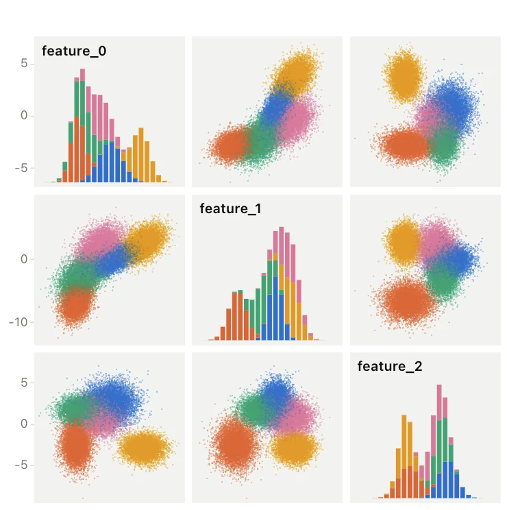

# PairPlot API

<!-- no-md -->
<div class="wiggly-demo-wrap">
<button class="wiggly-demo" type="button" data-demo="pair_plot" data-demo-title="PairPlot live demo">

<span class="wiggly-demo__cta">Run this demo live in your browser <span class="wiggly-demo__play">▶</span></span>
</button>
</div>
<!-- /no-md -->

`PairPlot` shows every pair of numeric columns as a scatter plot, with a
histogram of each column on the diagonal. Select rows in one cell and they
light up in all the others.

```python
import numpy as np
from wigglystuff import PairPlot

X = np.random.default_rng(0).normal(size=(1_000_000, 8))
labels = np.random.default_rng(1).integers(0, 5, size=len(X))

plot = PairPlot(X, color=labels)
plot
```

DataFrames work too. `color` can then be a column name, and the other numeric
columns become the dimensions (pick them with `columns=`):

```python
PairPlot(df, color="species")
PairPlot(df, columns=["bill_length", "bill_depth", "body_mass"], color="species")
```

## Selecting rows

- **Drag** inside any scatter cell to draw a **box**, or switch to **Lasso** in
  the toolbar (or pass `mode="lasso"`) for a freehand outline.
- **Drag a selection** to move it. Every cell and histogram updates while you
  drag; Python receives the new `selection` when you let go.
- Selected rows keep their category color; everything else turns gray. The
  diagonal shows the selection stacked on top of the full histogram.
- **Click** outside the selection, double-click, or press **Clear** to clear it.

The selection is synced as a small description in data coordinates, not as a
list of row indices, so it stays cheap at a million rows:

```python
{"type": "box", "x_index": 0, "y_index": 1,
 "x_min": -1.2, "x_max": 0.8, "y_min": -0.5, "y_max": 2.1}
{"type": "lasso", "x_index": 0, "y_index": 1, "vertices": [[x, y], ...]}
```

Python evaluates it against the full data, so these are exact:

```python
plot.selected_count    # number of selected rows
plot.get_mask()        # boolean NumPy mask
plot.get_indices()     # integer row indices
plot.selected_data     # selected rows, same type as the input
```

## Keep, Exclude, Reset

Like the [parallel coordinates](parallel-coords.md) widget, a selection can
become a filter:

- **Keep** drops every row outside the selection.
- **Exclude** drops every row inside it.
- **Reset** brings every row back.

After a filter the axes and histograms animate to the rows that remain, which
works as a zoom. Filters stack and are synced as the `filters` list, which
Python replays to get exact results. The same actions exist in Python:

```python
plot.keep()               # or plot.exclude()
plot.get_active_mask()    # rows left after the filters
plot.active_data          # those rows, same type as the input
plot.reset()
```

New selections only count rows that are still in the plot.

## How it scales

The numbers go to the browser once, as binary float32, and stay in a Web
Worker. WebGL draws a sample of at most `max_marks` points spread across the
cells (with 8 dimensions, about 36,000 per cell), while counts, histograms and
selections use every row. At a million rows a selection takes a few tens of
milliseconds, so a box keeps up while you drag it. Point size and opacity
adapt to how crowded a cell is unless you set `point_size`.

Non-finite values are skipped in the axes, histograms and selections. Up to
eight categories get distinct colors by default; pass `color_map` to choose
your own.

::: wigglystuff.pair_plot.PairPlot

## Synced traitlets

| Traitlet | Type | Notes |
| --- | --- | --- |
| `selection` | `dict` | Current box or lasso in data coordinates, or `{}`. |
| `selected_count` | `int` | Exact number of selected rows (after filters). |
| `filters` | `list[dict]` | Keep/Exclude steps: `{"action": "keep" \| "exclude", "selection": {...}}`. |
| `mode` | `str` | Selection tool: `"box"` or `"lasso"`. |
| `layout` | `str` | `"full"` matrix or `"lower"` triangle. |
| `columns` | `list[str]` | Dimension names. |
| `categories` | `list[str]` | Color categories, in sorted order. |
| `palette` | `list[str]` | One CSS color per category. |
| `cell_size` | `int \| None` | Cell size in pixels; `None` fits the available width. |
| `point_size` | `float \| None` | Point diameter in pixels; `None` adapts to density. |
| `max_marks` | `int` | Budget of points drawn across all cells. |
| `status` | `str` | `"loading"`, `"ready"` or `"error"`. |
| `error` | `str` | Error message from the browser, if any. |
