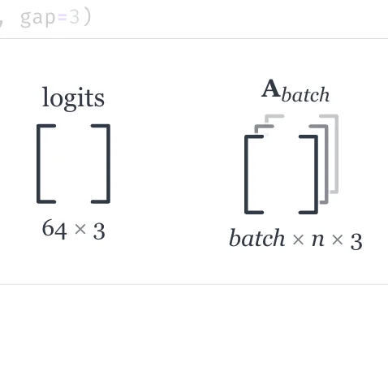

# shape_display API

<!-- no-md -->
<div class="wiggly-demo-wrap">
<button class="wiggly-demo" type="button" data-demo="shape_display" data-demo-title="shape_display live demo">

<span class="wiggly-demo__cta">Run this demo live in your browser <span class="wiggly-demo__play">▶</span></span>
</button>
</div>
<!-- /no-md -->

marimo prints arrays in full. When the story is "this cell holds a 128×2
matrix", the 256 numbers underneath are noise. `shape_display` returns a real
`numpy.ndarray` subclass whose marimo output is just the *shape*: empty matrix
brackets with a caption underneath.

```python
import numpy as np
from wigglystuff import shape_display

X = shape_display(np.zeros((128, 2)), labels=("n", None), name=r"$\mathbf{X}$")
```

`X + 1`, `X[:10]`, `X.T`, and every other NumPy operation keep working, and
array-valued results keep the display. Use `.value` whenever you want the same
data as a plain `ndarray` again.

## labels

One entry per axis, set at construction or later through the property:

- a **string** renders as a symbolic dimension — `"n"` stays `n`, whatever the
  actual size is that day;
- `None` renders that axis's **live size**, so growing the data updates the
  caption.

`("n", None)` on a `(128, 2)` array reads *n × 2*. An axis keeps its label
through an operation only while it keeps its size, so the caption never lies:
elementwise math keeps every label, `X @ W` on an *n × d* and a *d × k* array
reads *n × 3* (the `d` axis is gone, the new one shows its live size), and
`X[:10]` or a reshape fall back to concrete sizes on the axes that changed.
Axis permutations (`transpose`, `.T`, `swapaxes`, `rot90`, `moveaxis`)
reorder the labels. Results with fewer dimensions — a row sum, a mean — fall
back to marimo's plain display.

For 3D arrays the glyph becomes three bracket pairs stacked like sheets of
paper: each sheet hides whatever falls behind it, so the planes never blend
into each other and the interior of the front brackets stays empty.

## name

An optional label above the glyph:

```python
shape_display(np.zeros((64, 3)), name="logits")
shape_display(np.zeros((4, 4)), name="X")                    # lone letter: italic
shape_display(np.zeros((4, 4)), name=r"$\mathbf{X}$")        # bold X
shape_display(np.zeros((32, 8, 3)), name=r"$\mathbf{A}_{batch}$")
```

Plain strings render in serif — a lone letter as an italic math variable,
anything longer (words, phrases) upright. Strings that contain TeX commands or
are wrapped in `$...$` render with the KaTeX that ships with marimo, so you
get real TeX without extra JavaScript or a dependency, and it works offline.

The name sticks to views of the same data (slices, reshapes) and is inferred
for two operations: `@` puts the operand names side by side, and a 2D
transpose adds a superscript T.

```python
X.T        # named Xᵀ
X @ W      # named XW
X.T @ X    # named XᵀX
```

Other computed results, such as `X + 1` or `np.concatenate([X, X])`, drop the
name, since they are no longer that variable. Inference needs both operands
named (`X @ np.ones(...)` is unnamed) and only covers the `@` operator, not
`np.dot`. To name any result, call `set_name`, which returns a view with the
new name and leaves the original alone:

```python
(X + 1).set_name(r"$\mathbf{X}'$")
```

Every glyph reserves room for a name, so named and unnamed arrays still line
up when you `mo.hstack` them.

Arrays pickle with their labels and name, so `mo.persistent_cache`, joblib,
and multiprocessing work.

`shape_display` is a marimo-only display helper. The glyph comes from
marimo's `_display_` hook and TeX names use marimo's built-in KaTeX, so plain
Jupyter shows the ordinary NumPy repr instead. The array itself still works
there; nothing raises.

Requires NumPy when used (`pip install wigglystuff[numpy]`); the rest of
wigglystuff imports fine without it.

::: wigglystuff.shape_display.shape_display
