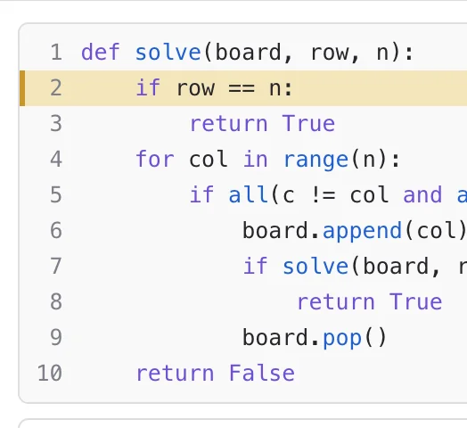

# StateViewer API

<!-- no-md -->
<div class="wiggly-demo-wrap">
<button class="wiggly-demo" type="button" data-demo="state_viewer" data-demo-title="StateViewer live demo">

<span class="wiggly-demo__cta">Run this demo live in your browser <span class="wiggly-demo__play">▶</span></span>
</button>
</div>
<!-- /no-md -->

`StateViewer(search_func, view_func)` runs `search_func` once and records every
line it executes, including recursive calls. At each step it calls `view_func`
with the function's local variables, then plays the whole run back:

- **left**: whatever `view_func` drew for that step;
- **right**: the source with the line *about to run* highlighted, and a table of
  the function's variables. Rows stay fixed, values that just changed flash, and
  variables that aren't set yet show *not assigned*;
- **bottom**: play/pause/step buttons, a speed slider, a badge with the current
  timeline value, and a timeline of the whole run. Click or drag the timeline to
  scrub, or focus the widget and use ← / → (Shift jumps 10), Home / End and Space.

It's made for search problems, where the interesting part is how the state
changes on the way to an answer.

## Quick start

Backtracking search for N-Queens, with a view that prints the board:

```python
from wigglystuff import StateViewer

def solve(board, row, n):
    if row == n:
        return True
    for col in range(n):
        if all(c != col and abs(c - col) != row - r for r, c in enumerate(board)):
            board.append(col)
            if solve(board, row + 1, n):
                return True
            board.pop()
    return False

def view(board, n):
    rows = ["." * c + "Q" + "." * (n - c - 1) for c in board]
    return "<pre>" + "\n".join(rows) + "</pre>"

StateViewer(solve, view, args=([], 0, 8))
```

`args` and `kwargs` are passed to `search_func`. The run is recorded when the
widget is created; playing it back doesn't run your code again.

## How `view_func` gets its values

`view_func`'s **parameter names pick the locals it receives**. `def view(board, n)`
gets the live `board` and `n` from the frame that's running. In a recursive
search that's the innermost call.

- A parameter with a default is optional: it gets the default while that local
  doesn't exist yet. `def view(board, n, row=None, col=None)` works on every step.
- While a *required* parameter isn't assigned yet, the previous view stays up
  (and the panel is empty before the first one). So give a default to anything
  that's assigned partway through the function, or the opening steps show
  nothing.
- A `**kwargs` parameter receives every local.

Each view is drawn the moment its step is recorded, so in-place changes like
`board.append(col)` show up correctly.

`view_func` can return anything marimo can display: an HTML or SVG string,
`mo.Html`/`mo.md`, a dataframe, even a matplotlib figure. Plain strings are used
as HTML directly. Every *distinct* view is stored in the widget (repeats are
stored once), so small SVG strings are the best choice for long runs.

## Searches without recursion: `timeline_func`

By default the timeline plots **call depth**: how many calls to `search_func`
haven't returned yet. That shows a backtracking search's dives and retreats, but
a loop-based search never calls itself, so its depth stays at 1 and the timeline
is a flat bar.

A loop-based search keeps its progress in a data structure instead, so tell the
timeline what to plot. `timeline_func` picks its locals by parameter name, just
like `view_func`, and returns a number:

```python
def search(maze, start, goal, breadth_first):
    frontier = [start]
    came_from = {start: None}
    while frontier:
        node = frontier.pop(0) if breadth_first else frontier.pop()
        if node == goal:
            break
        r, c = node
        for nxt in [(r - 1, c), (r, c + 1), (r + 1, c), (r, c - 1)]:
            if maze[nxt[0]][nxt[1]] != "#" and nxt not in came_from:
                came_from[nxt] = node
                frontier.append(nxt)
    ...

StateViewer(
    search,
    maze_view,
    args=(MAZE, (1, 1), (8, 15), True),
    timeline_func=lambda frontier: len(frontier),
    timeline_label="frontier size",
)
```

The badge and the caption show `timeline_label`. It defaults to the function's
name, or "value" for a lambda. Before the parameters exist the value is 0, and
it must be a finite number. In the demo, the same function plotted this way
shows breadth-first search keeping a narrow band while depth-first search's
stack piles up.

## Driving other widgets

`view_func` is optional. Without it the widget shows just the code, variables and
timeline, and you draw the state with any other widget instead:

- `step` is synced back to Python while you play and scrub, at most once every
  `sync_throttle_ms` (default 100; `0` syncs every step).
- `viewer.state` holds the real local values at that step, not reprs. They're
  copied when the step is recorded, so later in-place changes don't affect them.
- `variables=["board", "row"]` limits the table to those names in that order.
  `state` still holds every local.

```python
viewer = StateViewer(solve, args=([], 0, 8), variables=["board", "row", "col"])
viewer.observe(lambda _: redraw(viewer.state["board"]), names="step")
```

In marimo, wrap the viewer in `mo.ui.anywidget` and update another widget from a
cell that reads `viewer.widget.state`. Assign to that widget's traitlets rather
than creating a new one, so it keeps its own state. The demo uses this to drive a
rotatable three.js board.

## Reading the trace from Python

- `viewer.steps` is the full trace, one record per step:
    - `line`: the line about to run (1 = the `def` line; decorators are left out of `code`);
    - `depth`: call depth;
    - `event`: `"line"`, `"return"` or `"raise"`;
    - `locals`: reprs of the shown variables;
    - `view`: an index into `views` (`-1` = nothing drawn yet);
    - `value`: the `timeline_func` value, if you passed one;
    - `returned`: on return steps, the returned value's repr.
- `viewer.step`, `viewer.current` (the record at `step`), `viewer.state` and
  `viewer.n_steps`.
- `viewer.returned` is the repr of the result, `viewer.truncated` says whether
  `max_steps` was reached, and `viewer.error` is set if `search_func`,
  `view_func` or `timeline_func` raised. Errors are shown in the widget rather
  than raised, with the line they happened on.

## Limits

- **Only `search_func` itself is recorded.** Calls into helper functions run but
  aren't recorded, and neither are functions defined inside it or the generator
  expression in an `all(...)` check. If the interesting work happens in a helper,
  trace the helper.
- `search_func` needs Python source you can inspect: a plain `def` in a file or
  notebook cell works best. Builtins and bound methods (`obj.solve`) raise a
  `TypeError`. For a method, pass `Class.solve` and the object in `args`.
- Generator functions and `async def` functions record zero steps: calling them
  only creates the generator or coroutine and doesn't run the body.
- `max_steps` (default 20,000) stops recording a runaway search and sets
  `truncated`. `only_changes=True` keeps only steps whose view (or, without a
  view, whose shown values) differs from the previous step.
- Threads started by `search_func` aren't recorded; only the thread that
  creates the widget is.
- Every step copies the locals (for `state`) and repr's them (for the table), so
  very large objects make recording slower.

See also: [LiveEdit](live-edit.md) for a table of every loop iteration of one
run, and [AsyncFlow](async-flow.md) for async tasks.

::: wigglystuff.state_viewer.StateViewer

## Synced traitlets

| Traitlet | Type | Notes |
| --- | --- | --- |
| `code` | `str` | Source of `search_func` (decorators dropped). |
| `lines` | `list[dict]` | Syntax tokens per source line, for highlighting. |
| `steps` | `list[dict]` | One record per step; see [Reading the trace from Python](#reading-the-trace-from-python). |
| `views` | `list[str]` | Distinct rendered views as HTML; `steps[i]["view"]` indexes into it. |
| `variables` | `list[str]` | Rows of the variables table: every local the run assigns, or the names passed as `variables=`. |
| `step` | `int` | Current step. Synced while playing and scrubbing, and settable from Python. |
| `playing` | `bool` | Whether playback is running. |
| `interval_ms` | `int` | Milliseconds per step while playing. |
| `loop` | `bool` | Restart from the first step at the end. |
| `timeline_label` | `str` | What the timeline plots: `"call depth"`, or the label for `timeline_func`. |
| `sync_throttle_ms` | `int` | Minimum milliseconds between `step` syncs while playing or scrubbing. |
| `returned` | `str \| None` | Repr of the return value. |
| `error` | `dict \| None` | `{type, message, source, lineno}` when `search_func`, `view_func` or `timeline_func` raised. |
| `truncated` | `bool` | Whether `max_steps` was reached. |
| `height` | `int` | Height cap in pixels (`0` = fit content). |
