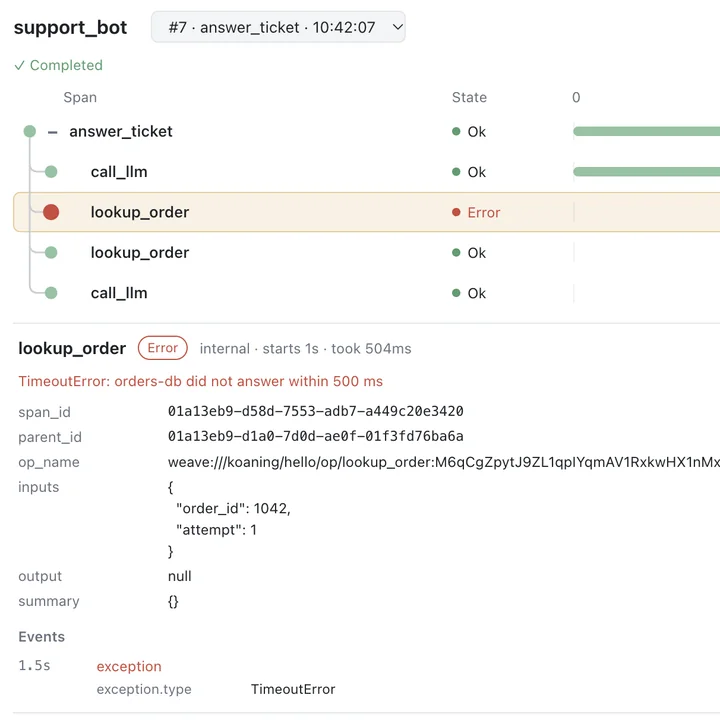

# TraceView API

<!-- no-md -->
<div class="wiggly-demo-wrap">
<button class="wiggly-demo" type="button" data-demo="traceview" data-demo-title="TraceView live demo">

<span class="wiggly-demo__cta">Run this demo live in your browser <span class="wiggly-demo__play">▶</span></span>
</button>
</div>
<!-- /no-md -->

`TraceView` shows an OpenTelemetry trace as a waterfall. Each span is a row,
indented under its parent, with its state (pending, running, ok, error), a bar on
a shared timeline, and its duration. Click a row to see its attributes and
events, fold a subtree with `−`/`+`, and press **Replay** (or drag the scrubber)
to watch the trace unfold. Span *links* — "caused by, but not part of", like a
queue consumer pointing at the producer — are drawn as dashed curves.

There are three ways to get spans in:

- **Live, in-process** — `view.span_processor()` is an OpenTelemetry
  `SpanProcessor`. Add it to a `TracerProvider` once; from then on every span
  made by that provider's tracers streams into the widget as it starts and
  ends, and running spans grow live. There is no widget-level context manager
  for this because OpenTelemetry already has one: `with
  tracer.start_as_current_span(...)` is the block, and the widget sees it.
  Needs `opentelemetry-sdk` (`pip install wigglystuff[otel]`). Anything built
  on OpenTelemetry, such as Logfire or Pydantic AI, can use the same processor.
- **From data** — `TraceView.from_otlp(...)` reads OTLP/JSON (a dict, a list of
  dicts, a file, or the JSON lines the Collector's file exporter writes), and
  `TraceView.from_spans(...)` takes SDK spans such as
  `InMemorySpanExporter.get_finished_spans()`. Loading OTLP needs no
  OpenTelemetry install.
- **From W&B Weave** — `with view.capture_weave():` shows the calls of any
  `@weave.op` function called inside the block, live, after `weave.init(...)`
  (`pip install wigglystuff[weave]`). Weave has no processor hook, so this
  context manager is the Weave stand-in for `add_span_processor`: it hooks the
  Weave client for the duration of the block and unhooks it afterwards. The
  spans themselves still come from your `@weave.op` calls, just as they come
  from `start_as_current_span` with OpenTelemetry. `TraceView.from_weave(...)`
  loads stored calls from `client.get_calls(...)` (or the service API's call
  dicts).

```python
from opentelemetry.sdk.trace import TracerProvider
from wigglystuff import TraceView

view = TraceView(title="agent run")
provider = TracerProvider()
provider.add_span_processor(view.span_processor())
tracer = provider.get_tracer("notebook")

with tracer.start_as_current_span("agent.run"):  # this block is the trace
    ...
```

With Weave, call your op as usual inside the block:

```python
import weave
from wigglystuff import TraceView

weave.init("my-project")
view = TraceView(title="support bot")
view  # display it, then in another cell:

with view.capture_weave():
    answer_ticket("Where is my order?")
```

A span with numeric `progress.done` and `progress.total` attributes gets a
progress bar. Updates are sent from the thread that starts or ends a span, so
spans finishing on background threads show up with the next update from the
notebook's own thread. asyncio needs nothing extra: spans started inside tasks
keep their parent through `contextvars`, so concurrent work shows as
overlapping bars under one parent.

Picking an older trace from the menu pins it on screen. While *Follow latest*
is on (the default, `show_latest=True`) the next trace that starts takes the
view back to following live. Click the button, or set `show_latest=False`, to
keep the picked trace pinned instead.

See also: [AsyncFlow](async-flow.md) for a timeline of asyncio tasks without any
instrumentation, and [LiveEdit](live-edit.md) for a pass-by-pass trace of one
Python function.

::: wigglystuff.trace_view.TraceView

## Synced traitlets

| Traitlet | Type | Notes |
| --- | --- | --- |
| `spans` | `list[dict]` | Normalized spans: `span_id`, `parent_id`, `trace_id`, `name`, `service`, `kind`, `start_ms`, `end_ms` (epoch ms, `None` while running), `status`, `status_message`, `attributes`, `events`, `links`. |
| `trace_id` | `str` | Trace on screen; `""` follows the most recently started one. |
| `show_latest` | `bool` | *Follow latest* button: a new trace clears a pinned `trace_id`; turning it on jumps to the latest trace. |
| `selected_span_id` | `str \| None` | Set by clicking a row; read the span with `selected_span`. |
| `cursor_ms` | `float \| None` | Replay position in ms since the trace started; `None` shows everything. |
| `collapsed` | `list[str]` | Span ids whose subtrees are folded. |
| `title` | `str` | Header title. |
| `height` | `int` | Max height of the rows in pixels; `0` grows to fit. |
| `now_ms` | `float` | Kernel clock at the last sync, so running bars grow correctly. |
