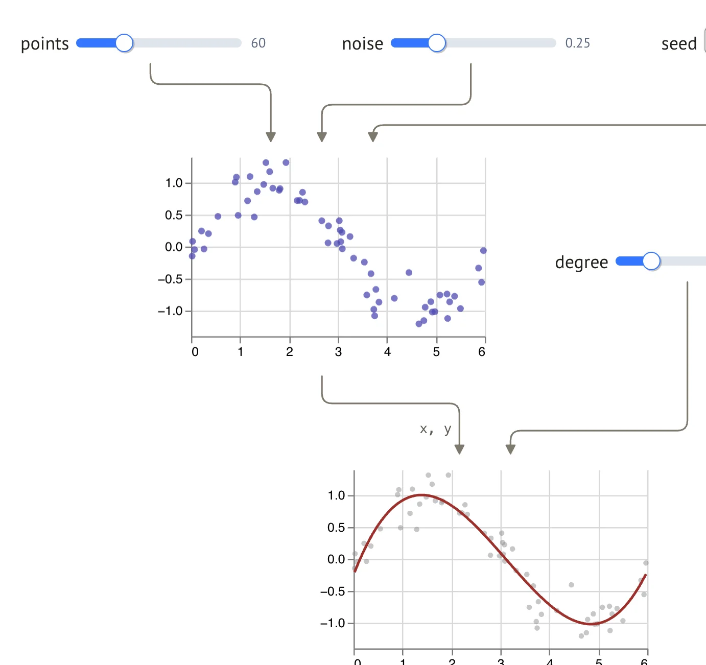

# WidgetFlow API

<!-- no-md -->
<div class="wiggly-demo-wrap">
<button class="wiggly-demo" type="button" data-demo="widget_flow" data-demo-title="WidgetFlow live demo">

<span class="wiggly-demo__cta">Run this demo live in your browser <span class="wiggly-demo__play">▶</span></span>
</button>
</div>
<!-- /no-md -->

`WidgetFlow` is a marimo display helper rather than an AnyWidget. It lays live
widgets (or any renderable: charts, images, `mo.stat`, ...) out as a layered
DAG in the style of [FormulaDAG](formula-dag.md). You pass the widgets and the
arrows between them as pairs of the same objects. You can also skip the edge
list: `WidgetFlow.from_widgets([...])` reads the edges off marimo's dataflow
graph and captions each widget with its variable name. The widgets stay live
and reactive, because the flow only arranges references to them.

The layout is in your hands where it matters. Edges take labels, colours,
dashes and explicit `exit`/`enter` ports, and ported arrows route around the
other widgets. `beside` puts a widget next to the one it feeds, `layers` pins
a widget to a later layer, and `align` packs every layer onto one shared grid,
so a chain of widgets down a column gets straight arrows. `notes` hang an
explanatory note beside a widget.

Parts of the flow can be hidden and brought back. Widgets in `collapsible`
get a hover button that folds them to a pill showing their caption. `groups`
draw a dashed frame whose tab folds a whole stretch of the flow into one pill,
and the arrows in and out of the group re-aim at the pill. Folding happens in
the browser, so nothing is laid out again and every widget keeps its state.
Nest one `WidgetFlow` inside another to treat a sub-flow as a single node.

See also: [WidgetDAG](widget-dag.md) for a simpler column layout,
[FormulaDAG](formula-dag.md) for formulas wired by `\use{name}`, and
[Hint](hint.md) for a single arrow from a note to a widget.

::: wigglystuff.widget_flow.WidgetFlow

## Folding parts of the flow

```python
WidgetFlow(
    [drawing, X, noise, X_noisy, Z, weights, Y, angle, plots],
    edges=[...],
    collapsible=[drawing, plots],              # hover button on these
    groups=[("Z → Y", [Z, weights, Y, angle])],  # dashed frame + tab
    collapsed=[plots],                         # start folded
)
```

A group must include every widget on a path between two of its own widgets,
because the pill replaces them all. Arrows that end up joining the same pair
of nodes once the group folds stay separate when they land in different
spots.

## Notes

`WidgetFlow` is a marimo-only display helper. Its arrow overlay reaches into
marimo's rendered DOM to draw in the same coordinate space as the widgets, so
it does not work in plain Jupyter. In Jupyter it raises a clear error instead
of printing a silent repr.
